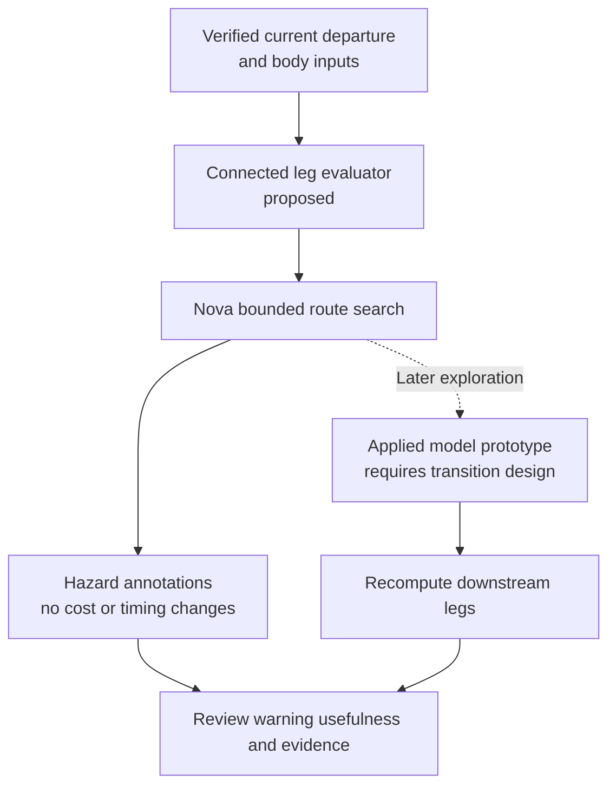
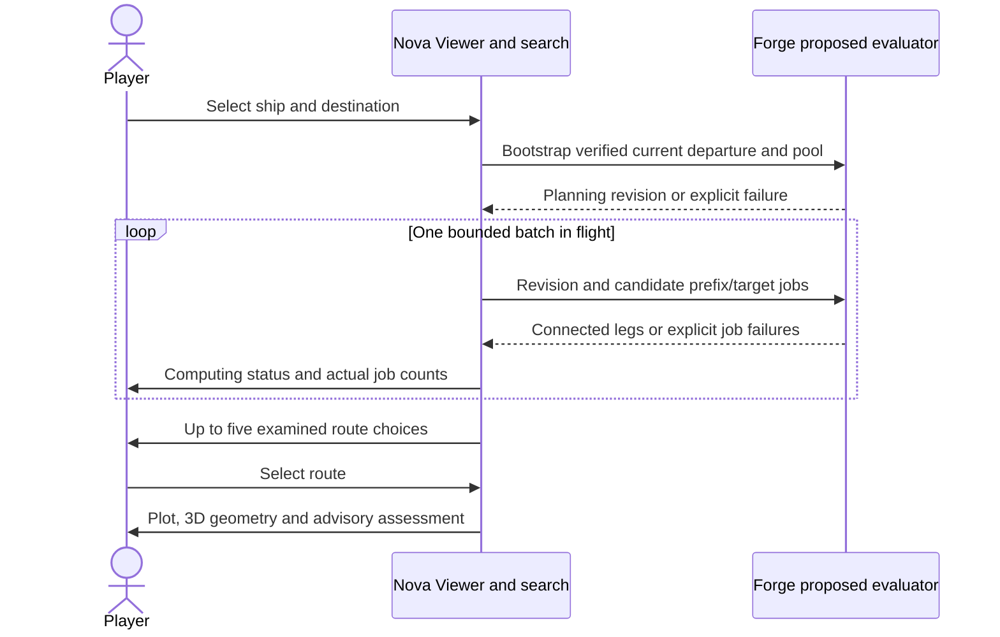
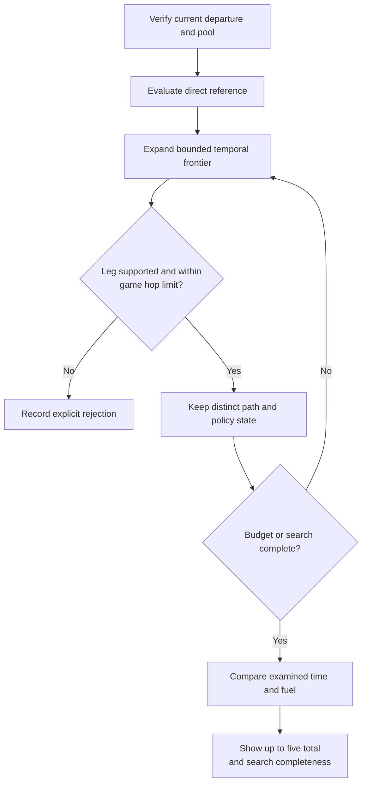

<!-- Print support: forces black text when printing from a browser markdown viewer. -->
<style>@media print { *, *::before, *::after { color: #000 !important; text-shadow: none !important; } }</style>

# Ship navigation: Phase 3 planning draft

> Historical planning record, not current implementation guidance. Phase 3
> was subsequently implemented and several product decisions changed. See the
> [current navigation handoff](./ship-navigation-2026-11-14.md#phase-3-frontend-closeout-2026-11-23)
> and the served OpenAPI for current behavior and contract details.

Date: 2026-11-21
Status at the time: Design only. No implementation, OpenAPI change, data generation, world
mutation, server restart, or commit is authorized.

This draft supersedes earlier Phase 3 proposals in this file. For accepted
Phase 1 and 2 behavior and historical evidence, see the
[navigation handoff](./ship-navigation-2026-11-14.md). A read-only backend
review confirmed the current-time and procedural-data gaps; their proposed
solutions still need OpenAPI design and approval.

## Planning focus

The owner asked to keep this session focused on **Sol navigation planning**.
Use saved ship coordinates as the game's current position and the existing
Sol navigation model as the starting point for route calculations. The
coordinate contract needs a consistent interpretation, but no evidence
currently calls for changing every coordinate or performing a mass migration.
Do not expand this planning session into a universe-wide coordinate redesign.
The owner explicitly deferred universe-wide coordinate redesign and detailed
clock crash recovery to later work. Neither is a prerequisite for the
initial route-calculation design.

Prior clock, storage, transfer and placement discussions below are retained as
background and follow-ups, not a mandate to solve every subsystem before
continuing route design. The selected current-game-time requirement still
needs a suitable backend clock and source contract; record any real blocker
when it becomes relevant rather than claiming that a missing capability exists.
Route planning will consume the backend's saved starting position. For newly
purchased ships the owner wants randomized outside-station placement, which
does not exist yet. Cold Boot instead begins in an asteroid belt; preserve
its existing new-character mission rather than assuming a station start.

### Deferred transfer-crash journal and its fanout

The owner has deferred the proposed navigation journal and the associated
crash-safe transfer design as **optional future work**, not a prerequisite
for calculating Phase 3 routes. This supersedes the earlier direction to pursue
a transfer coordinator now. The research below is historical design context;
where it describes mandatory journal-related behavior or release gates, read
those statements as conditional on a future decision to adopt that design.

The deferred fanout includes the per-ship journal/coordinator and
tombstones; trusted producer-event provenance, sequencing and per-action
high-water evidence; transaction-versus-journal and related topology choices;
write-path orchestration and cross-document projection replay;
committed-pending transfer responses, status/retry APIs and recovery UX;
character-deletion barriers introduced to retain that evidence; journal startup
scans, singleton/fencing and durability controls specifically for that
journal; extra rollback/revocation infrastructure for those guarantees; and
their related crash/restore tests. Existing gameplay transfers must not be
changed or blocked merely because this optional architecture is absent.

Retain normal route needs: an authenticated read of the current saved ship
position, a current game epoch, validation/invalidation when selection,
ownership or position changes, and explicit handling of unavailable inputs.
Signed capture tokens are also optional future work, not needed for the
initial navigation design. The method for associating related calculations
with the same inputs remains to be determined.
Stale-route tracking, age limits, stale labels and a dedicated Recalculate
action are also optional future work. Each new route search starts from current
information; existing protections against applying responses to a different
ship or destination still apply.
The owner's separate shared-clock and checkpoint direction remains recorded.
Without a trusted event protocol, however, do **not** claim the previously
discussed committed-event high-water reconciliation or cross-document
crash-safe transfer guarantee has been implemented or verified.

## Product direction

- Offer up to **five routes total**, including a direct reference when
  supported. The player selects a route and compares estimated game time and
  fuel. Show fewer than five when appropriate; do not fabricate alternatives.
- Search initially among at most ten Sol planets and moons, with at most five
  encounters per route and no repeated candidate body. Choose the candidate
  pool automatically. Revisit these limits using representative scenarios.
- Evaluate both flyby sides. When sides only affect display or advisory
  diagnostics, they are variants of one costed route. The selected calculated
  offset points can themselves produce different distances and times without
  applied gravity. Each side must be calculated independently; sides with
  different costs are separate route choices within the five-route limit.
- Retain separate time and fuel comparisons rather than an unexplained combined
  score. Show the shortest eligible route examined and longer alternatives
  when available, even when an alternative costs more in both time and fuel.
  These still count toward the five-route total alongside the direct reference;
  exact selection and ordering remain design work.
- Fill remaining route slots with a mix of lower-cost choices and routes
  visiting different flyby bodies. Explain why each route was selected, using
  reasons supported by the routes actually examined. With a direct reference
  and four alternative slots, aim for roughly two lower-cost choices
  (including the shortest eligible route examined) and two choices selected
  for flyby diversity. Fill unused slots with other available choices; do not
  fabricate routes. If the direct reference is itself the shortest eligible
  route, label it accordingly instead of duplicating it.
- Let the player order route alternatives by time or fuel. Favor examining
  more alternatives before showing results, even if it takes longer, and show
  clear activity indicators while the search runs. If no eligible route is
  found, show the direct reference and explain the result.
- Start a new search with a **Plan Route** button. Draw the selected route
  and direct reference, and list flyby bodies in each route's comparison row.
  If a search is interrupted or reaches its limit, show completed choices and
  clearly label the search incomplete; never present partial legs as a route.
  Keep the initial search flow simple: allow a search to finish or time out.
  On timeout, warn the player and allow another search with Plan Route. Do not
  add source-change monitoring or automatic retries solely for this purpose;
  preserve existing ship/destination identity protections and surface any
  source-consistency errors returned by the backend.
- A representative use case is delivering cargo to a destination market the
  player has already chosen. The player may prefer a slower route that uses
  less fuel. Market pricing and market-data integration are outside this
  navigation planning discussion.
- Use a Tier 1 prototype: 0.3 AU/hour and 1 prototype fuel unit/AU. Its 0.5 AU
  limit is a **per-leg gameplay hop limit**, not a whole-trip range or
  automatic refueling rule. The owner confirmed keeping this limit and the
  five-encounter limit; together they imply at most 3 AU of eligible path
  length. A longer direct reference remains displayable but not eligible.
  Fuel supply, support and actual consumption remain out of scope.
- Approximate game travel time must start from a backend-verified **current
  game epoch and ship position**. The owner clarified that a ship's currently
  saved coordinates are where the game considers it to be; use that current
  saved state as the starting position, subject to ownership, basis and
  consistency checks. Do not treat its old snapshot epoch as a trusted clock
  event or invent historical movement. Format elapsed uniform game
  milliseconds as hours/days; no physical time conversion or execution
  countdown is implied.
- All celestial bodies and game coordinates, including ships and stations,
  must use the same game coordinate system. The existing contract does not
  guarantee a common basis; this is a contract gap, not evidence that stored
  vectors actually differ. Origin, axes, units, scope and any necessary
  transformations or migration require a separate evidence-based design.
  Universe-wide redesign is deferred; current navigation planning focuses on
  using a consistent Sol basis.
- The shared universe clock normally advances one game second per real second,
  including while players are offline, but pauses while the server is stopped.
  Authorized server controls may pause it for everyone. Fast-forward is
  deferred until its wider gameplay implications are considered. When a new
  game clock is first created, initialize it once from the server's current
  UTC date and time. Subsequent restarts use persisted game time and do not
  add stopped-server time.
- After an unexpected crash, recover from the last durable clock checkpoint
  and accept a bounded lost interval; never add stopped-server downtime.
  The owner selected **five minutes** as the initial maximum uncommitted
  game-time loss target; the checkpoint schedule and evidence for meeting the
  target remain to be designed and tested. A failed or late durable checkpoint
  must not be presented as a proven bound.
  Recovery must invalidate affected planning captures; do not silently
  retimestamp persisted state or treat an unproven epoch as a committed
  game-time event.
  Forge's design review distinguishes proven game-clock events from legacy
  spatial epochs and wall/audit timestamps. If a trusted committed game-time
  event is ahead of the checkpoint, the owner chose to preserve the event and
  advance only to its verified epoch. The owner selected a separate maximum
  recovery advance of **five minutes**, matching the uncommitted-loss target.
  That verified-event forward-recovery policy depends on evidence and
  coordination that are now optional future design; it is not a demonstrated
  Phase 3 guarantee. Detailed crash recovery and its implementation are
  deferred; these previously discussed targets are not an initial route-design
  gate. Do not infer conflicts from legacy timestamps.
- Design the first current-position producers for both durably docked ships
  and backend-certified fixed-position ships. Existing purchase lineage alone
  does not certify either ongoing state. The owner considers these lifecycles
  valuable to establishing where a route starts.
- For the initial station-following producer, use the existing validated Sol
  catalog Kepler model as the game-coordinate station-pose authority for
  supported bundled Sol stations. The earlier zero-offset-only direction must
  be revisited in light of the owner's new outside-station purchase-placement
  requirement; attachment, offset frame and lifecycle remain to be designed.
- Purchased ships need procedural randomized placement outside the station,
  keeping them from being too close to other docked ships. This capability
  does not yet exist. Cold Boot is the initial mission after new character
  creation and is designed to start in an asteroid belt, not at a station.
  Preserve that existing mission when designing any starting-position
  improvements. Navigation will consume the saved coordinates as its starting
  position. No placement or data mutation is authorized yet.
- Each station may eventually have its own parking-orbit layout. Initially,
  place purchased ships randomly in a defined station plane and have docked
  ships follow the station. Spacing should account for ship and station sizes,
  with maritime-inspired margins for bumpers and neighboring slips. If there
  is no safe space, expand the parking orbit outward in the same plane.
  Exact geometry, units and clearances remain to be designed.
- On ship transfer, invalidate the old navigation certification and require
  recertification before the new owner can plan a current-time route.
  Preserve existing transfer behavior; a journal or crash-safe transfer
  coordinator is not required by route planning.
- Start with **advisory flyby information**: annotate the planned route
  simply where it could pass close to hazards, in the spirit of a map warning.
  Initially cover modeled boundaries, atmospheres and rings for supported Sol
  planets, moons, dwarf planets and the Sun as applicable. Show
  unavailable hazard data on the affected body rather than hiding it. Show
  route markers that the player can select for simple details: body, hazard
  type and a short explanation. Check the entire planned route; show a single
  warning level when its estimated path comes within a warning distance.
  Display markers on the currently selected route. Evaluate the calculated
  route, not a decorative display curve, and make the distinction clear.
  Treat warnings as simple navigation aids analogous to harbor buoys, not
  physical clearance guarantees. Use a provisional 1000 km warning buffer
  outside known modeled hazard boundaries and revisit it after live-data
  validation. Use a coarse spherical ring warning envelope; the owner expects
  the ring plane to be known even though this approximation does not use it.
  Use the approved Sun-centered game atmosphere boundary of 20 solar radii
  (13914000 km from the center), with the 1000 km warning buffer outside it;
  no physical safety guarantee is implied. Other stars may require different
  boundaries and are outside the initial Sol survey. Diffuse circumsolar dust
  rings are deferred; planetary and moon ring hazards remain in scope.
  The approximation used to evaluate a moving body's proximity remains to be
  designed.
  For the initial celestial hazards, assume a completed survey: obtain
  complete hazard information as a hard Phase 3 requirement, preferring
  researched values. Include supported Sol planets, moons, dwarf planets and
  the Sun in the initial survey; this does not add them all to the candidate
  pool. When research does not find a hazard, the owner chose to
  assume it does not exist in the game and does not require an on-screen
  assumption label. Preserve the basis for this game assumption in survey
  provenance; do not claim it is an empirical finding. A failed or incomplete
  research or data-access process is not itself a completed survey.
  Pirate areas and procedurally created hazards may be introduced in future and
  are outside this initial assumption. The detailed acquisition
  method and any live-data changes need separate review and authorization.
  Unexpected incomplete inputs must still be reported explicitly; do not
  claim the survey requirement is satisfied when inputs are missing.
  When an encounter point overlaps another surveyed body's warning buffer,
  try a bounded set of alternative offsets; if none work, report that
  encounter unavailable. This check does not guarantee that the rest of the
  route avoids hazards.
  The owner considers physical/hazard inputs valuable and wants to revisit a
  physics-informed applied benefit later if complexity is reasonable. Advisory
  warnings do not change route time or fuel; unknown data must not be shown as
  a guarantee of safety.
- Forge owns authoritative data and calculation contracts. Nova owns
  client-side search, ranking, policy presentation, and Viewer geometry.

The existing [drive-profile prototype](../src/app/model/math/drive-profile.ts)
contains range, speed and fuel placeholders inferred from ship tier/model. It
is not an authoritative engine or fuel contract. At 1 AU = 149597870.7 km,
0.3 AU/hour equals 12466.489225 km/s, above the Phase 2 API's 10000 km/s
maximum. Do not silently clamp speed or change the old contract.

## Consolidated clock and departure proposal

The following is Forge's design-only proposal, not an existing OpenAPI
contract or authorization to implement. The current contract defines a uniform
millisecond scale, not an authoritative current game clock. Wall/audit
timestamps and legacy spatial snapshot epochs are not evidence of committed
game-time actions.

### Clock authority and recovery: earlier design research

The current-game-time requirement remains in scope. Detailed clock crash
recovery, including checkpoint targets and the trusted-event and cross-document
mechanisms below, is deferred research rather than an initial Phase 3 route
requirement or verified guarantee.

- Propose a single fenced authority, with other workers reading its clock.
  Durable state identifies the clock, game epoch, generation, monotonic durable
  sequence, run state and separate state revision. A monotonic elapsed source
  advances it at 1:1 only within an active authority term; do not infer game
  time from wall time. Leadership loss must fence the old authority and make
  time-dependent navigation unavailable until a successor has durable state.
  What operationally counts as the server being stopped and how to prove
  leader/supervisor lifecycle are unresolved deployment decisions.
- Pause freezes the epoch; clean stop flushes the checkpoint and stopped state.
  Restart does not add downtime. Recovery gates current departures and
  time-dependent writes. Whether any other game-time writes are permitted
  while the clock is deliberately paused still needs an explicit policy.
  Fast-forward remains deferred.
- Checkpoint cadence, deadlines and durable-write evidence must establish the
  separate five-minute **uncommitted running-time loss target**. If persistence
  fails or is too late to establish the bound, stop publishing or accepting
  affected time-dependent work and fail closed; do not claim a bounded loss.
  The crash instant and exact lost tail cannot be reconstructed from wall time.
- Let C be the last durable clock checkpoint and H the greatest verified
  committed event epoch in the navigation-trusted set, on the same prior
  clock lineage. If no such event exceeds C, recover at C. If H exceeds C
  by at most **300000 game ms**, validate provenance, sequence, producer state
  and relevant revisions, then recover forward only to H. Audit C, H, the
  contributing event IDs and sequence, lineage, bound and outcome. This
  separate recovery-advance limit does not prove the uncommitted-loss target.
  Missing or contradictory trusted evidence, an unknown lineage, an
  out-of-bound event, or an unestablished durability bound fails closed for
  clock-dependent navigation; retain committed records unchanged for
  resolution. Untrusted legacy timestamps do not contribute to H.
- Increment a durable clock generation after every unclean recovery before
  navigation reopens, even when resuming at C. Invalidate prior captures; no
  old departure is refreshed. If signed tokens are ever adopted, restoring
  both clock and generation storage to an older copy defeats their rollback
  detection; stronger guarantees need additional mechanisms.

The previously proposed trusted set covers clock lifecycle and the lifecycle of the two
eligible position producers, including any mutable station pose dependency.
Qualifying producer records need operation/event identity, authenticated server
producer, subject and event type/version, exact game epoch, clock lineage and
durable sequence, relation or attestation revision, relevant model/source
revisions and durable commit evidence. Producer state and that evidence must
commit atomically in the limited relevant write set, or an authoritative durable
operation journal must support idempotent projection and recovery. Periodic
clock checkpoints and a per-action durable high-water may be distinct; H can
then exceed C without losing the committed action. If neither mechanism is
available, the affected producer is unsupported. This is not a mandate to
rewrite unrelated ledgers or other game systems; any otherwise untrusted
producer that can change a required position dependency must be brought into
scope or the affected ship cannot be certified **under that optional
trusted-event design**. The saved-position route snapshot does not itself
require this journal.

#### Historical research: optional journal fanout

The following storage, deletion, transfer and recovery options were explored
for the deferred journal. None is a Phase 3 route-calculation prerequisite;
earlier recommendations to gate transfers or defer routes on that architecture
are superseded by the owner's scope decision.

Forge's subsequent read-only repository review found no configured Mongo
transaction/session usage, explicit durability policy, replica-set deployment
configuration or production topology evidence. The documented connection
supports a local Mongo URI or an externally supplied URI, but its actual
deployment settings were not inspected. The integration test helper uses a
standalone Mongo instance, so it does not demonstrate transaction support.
The backend can fall back to in-memory state when database connection fails;
that fallback cannot support a claimed durable clock or certified current
departure. Relevant evidence:
[Mongo connection](../../solid-train/src/db/connection.js),
[startup](../../solid-train/src/server.js),
[Mongo test helper](../../solid-train/test-support/mongodb-test-helpers.js).
The repository alone does not establish actual topology, effective write
concern, persistent storage, failover, backup/restore or replica count.

The owner subsequently reported a **standalone MongoDB deployment and one
backend instance**. MongoDB 8.2.11 runs in a Docker container with a Compose
disk mount that survives restart. There are currently no backups. The Node
server is the primary writer, and no other writers have been planned; this
does not establish enforced exclusivity or prevent administrative writes.
Storage engine, effective write concern and journal settings, host/disk failure
behavior and restore procedure remain unknown. A restart-persistent mount and
single instance do not by themselves establish durable writes, safe recovery
or fencing. These are owner-reported deployment facts; the repository review
did not independently verify them.

#### Storage options for the reported standalone deployment

These are design alternatives, not authorization or demonstrated guarantees.
All require verified durable storage, effective write/journal policy,
consistent backup/restore, measured checkpoint behavior and coverage of every
writer that can alter an eligible ship or required source. Ordinary legacy
events are not made clock-trusted.

| Option                                                    | Benefits                                                                                                                                                                                                     | Constraints                                                                                                                                                                                                                                                                                              |
| --------------------------------------------------------- | ------------------------------------------------------------------------------------------------------------------------------------------------------------------------------------------------------------ | -------------------------------------------------------------------------------------------------------------------------------------------------------------------------------------------------------------------------------------------------------------------------------------------------------- |
| A: single-node replica set and narrow transaction         | Atomically coordinate the clock high-water, producer event and state across the limited relevant documents; support a global action sequence and, if designed, eligibility-preserving cross-player transfer. | Requires separately approved topology migration and restart, transaction-capable test environment, retry/idempotency and durable storage. One replica-set member adds transaction support, **not** redundancy or backup.                                                                                 |
| B: standalone and independent per-ship navigation journal | Avoid a topology migration; a single-document conditional update can commit authoritative navigation state and its evidence together, subject to storage durability.                                         | No atomic player-plus-clock update, global action order or complete audit history; requires strict single-writer/fencing, mutation coverage and projection reconciliation. Cross-player transfer must fail safe, revoke eligibility and require recertification unless a stronger mechanism is designed. |
| C: defer current departures                               | Keep existing Phase 2 behavior and avoid claiming unsupported durability; continue design with explicit unavailable states or mock fixtures.                                                                 | Current-time Phase 3 departures remain unavailable.                                                                                                                                                                                                                                                      |

For **A**, preserve periodic checkpoint C separately from transactionally
committed action high-water H. A short transaction would condition on clock
generation and producer revisions, allocate the action sequence and write
event, state and H together; abort commits none. Route calculations do not
hold the transaction open. Standalone Mongo does not provide this
cross-document transaction path without a topology change.

For **B**, the earlier proposal to embed the only high-water evidence in a
Player document is insufficient: character removal, whole-character-array
replacement, compensation or Player deletion could erase it while C < H.
Revoking first in that same document does not fix a subsequent deletion.
Forge now proposes a separate clock/checkpoint document and an independent,
bounded authoritative navigation-journal document per immutable ship
incarnation. This revision is a design candidate, not an accepted protocol.

Each journal transition would atomically update one document using an expected
per-ship revision, recording an operation ID and digest, producer state,
event epoch and clock lineage, source/model evidence and retained high-water.
Retries use the same operation ID; conflicting revisions must be reconciled,
not blindly overwritten. A compact tombstone and high-water survive ship,
character and Player deletion, replacement, compensation and transfer.
Never reuse an incarnation ID. Retention and eventual safe pruning require
their own approved protocol; do not grow an unbounded event array. Per-ship
revisions do not create a global event sequence, full audit history or a
guarantee that a lost or restored-away event can be detected.

The journal would be authoritative for navigation eligibility; Player ship
data is a separate projection, not part of the same atomic commit. Proposed
certification records a pending transition first, updates the projection
idempotently, and becomes active only when journal and projection agree.
Revocation precedes an incompatible projection mutation; transfer revokes
eligibility and requires recertification for the new owner. A multi-ship
deletion or replacement must establish all necessary retained revocations
before changing the projection. Pending, missing or conflicting evidence
fails closed. Journal commits are not silently undone if projection fails.
Any startup projection replay needs separately approved recovery semantics;
navigation reads must never repair data as a side effect.

Recovery under B must block trusted writes, exclude competing and external
writers, scan all journal records and tombstones to completion, validate
trusted provenance, lineage, revisions and projections, derive H, and
conditionally advance the clock document and generation under the selected
bounded-forward rule. Incomplete scans, conflicting evidence or unproven
exclusivity fail closed. Define how valid pre-recovery producer records remain
usable across generations without retimestamping. Serialize clock lifecycle
and trusted operations through the authority; a single Node process alone
does not serialize asynchronous handlers. A separate counter update followed
by an event write does not create an atomic commit. Single-document atomicity
does not prove persistence, backup completeness or external-writer exclusion.

The read-only writer inventory identified relevant existing paths that a
future protocol must cover: Player character-array replacement and character
deletion; generic character saves and ship upserts; purchase and compensation;
transfer, piracy and salvage; the separate ShipRecord APIs; and market/body
seed or update paths. Some ownership handlers mutate in-memory ship state,
while the existing navigation capture uses Player-embedded ships rather than
the separate ShipRecord collection. Existing docking is proximity-based, not a
durable attachment. Source changes must fail validation or be integrated
into the trusted protocol. See
[player/character service](../../solid-train/src/db/service/player-character-service.js),
[ship upsert](../../solid-train/src/handlers/ship-upsert-message-handler.js),
[transfer](../../solid-train/src/handlers/ship-transfer-message-handler.js),
[market service](../../solid-train/src/handlers/context/market-service.js),
and [navigation state](../../solid-train/src/handlers/context/navigation-state-service.js).
The inventory covers inspected repository paths only, not external scripts,
database administrators or other deployments.

Forge recommends **C until durability and exclusive-writer requirements are
addressed**; backup/restore is deferred under the owner's planning assumption
below. B may fit the reported deployment if its limitations are acceptable
and its invariants are verified; A is preferable if cross-document atomic
eligibility or globally ordered events are required and migration is approved.
Neither option can reconstruct committed actions lost in a backup restore.
Incomparable/incomplete restored evidence requires a new lineage and explicit
resolution, not a guessed repair. No Mongo topology change, tests, migration
or implementation is authorized.

The owner chose to **explore B, the standalone approach**, including its
transfer limitations. This is a direction for further design, not approval of
the revised independent journal, projection recovery, transfer policy,
implementation or release. Current departures remain unavailable unless the
durability and safety prerequisites are demonstrated.

The owner subsequently stated they are comfortable losing recovery evidence
when a character is deleted. This does not by itself change the selected
global clock recovery policy or authorize loss of unrelated ships' evidence.
Consider an alternative serialized durable-checkpoint-before-deletion barrier:
preserve all relevant committed event high-water in the clock before allowing
the character's evidence to be erased; reject or defer deletion if the barrier
cannot be made durable. Its completeness across every deletion/replacement
path, crash behavior and consequences for retained audits still need review.
The owner accepted exploring this deletion-barrier tradeoff, including delayed
or failed deletion when durability is unavailable. This is not approval of a
specific protocol, the independent journal, implementation or data changes.

Forge's follow-up finds that a barrier can potentially simplify **character
deletion only**; it does not establish a general solution for transfer,
compensation, whole-player removal, admin reset or any other operation that
erases evidence. For an embedded-evidence candidate, a fenced coordinator
would quiesce relevant writers, completely scan and validate trusted records,
sample the authoritative game clock, then durably CAS a checkpoint at or
beyond both the sampled epoch and all relevant trusted H. Only after the
acknowledged checkpoint would it CAS-delete the specifically authorized
character and refresh authoritative caches. Other characters' evidence must
remain intact. On a scan, durability, exclusivity or revision failure, fail
or defer deletion rather than erase evidence. A crash after the checkpoint
but before deletion can leave the clock advanced even though the deletion did
not occur; the checkpoint itself is not proof of deletion.

This ordering depends on complete writer participation, enforced exclusion of
external writers, durable acknowledgments and safe cache invalidation; none
are demonstrated by the reported single process. It also does not retain
deleted navigation history or by itself define a durable game-time event for
the deletion. The owner confirmed that no separate exact deletion-time or
navigation-history record is needed for the deleted character; this does not
permit discarding other ships' evidence or unrelated committed actions.
Cross-player transfer
and other evidence-removing paths need separately designed durable
coordination or must leave affected ships unsupported; do not silently disable
existing gameplay workflows. Single-document CAS cannot make two Player
updates atomic. A consistent old restore can erase both checkpoint and
evidence without an internal rollback signal, so backup and recovery
prerequisites remain open.

#### Transfer coordination proposal

The owner chose to revoke a transferred ship's certification and require
recertification for the new owner. Forge found that the existing transfer
handler updates in-memory Player projections, while other ownership paths use
a separate ShipRecord; the reviewed code does not establish a single durable,
atomic transfer. The character-deletion exception does not authorize discarding
transfer evidence. See
[ship transfer](../../solid-train/src/handlers/ship-transfer-message-handler.js)
and [database service](../../solid-train/src/db/service.js).

For standalone Mongo, Forge proposes a bounded **independent per-ship
transfer/eligibility coordinator** as an alternative to an embedded-only
barrier. It would survive Player deletion and hold the logical owner,
owner/producer revisions, revoked or active certification, trusted event
high-water and one current operation with its identity and phase. A proven
universally present authoritative ShipRecord might serve this role, but
existing coverage and atomic revision checks have not been established.
The bounded record is not a full transfer-history audit.

The proposed logical commit is one durable, conditional coordinator update
that records the operation and trusted game epoch, assigns the new logical
owner, increments revisions and revokes certification. Player and any
required ShipRecord projections are then reconciled idempotently; ownership
and navigation use must fail closed while projections are pending or
conflicting. After a committed intent, recovery completes forward rather than
silently restoring the old owner or certification. A new certification is a
separate backend-authorized operation. A timeout with unknown commit outcome
requires checking the same operation ID, not creating a new transfer.

This needs an explicit contract for rejected-before-commit, committed-pending
and completed outcomes, plus a status/retry mechanism; the existing immediate
response must not misleadingly report failure after a committed transfer.
The owner accepted showing a committed transfer as pending, with the ship
unavailable until reconciliation finishes. The owner also chose to pursue
the per-ship coordinator as the standalone design direction; its exact commit,
retention and recovery semantics remain unapproved. The compatibility
and UX design require separate OpenAPI review. The approach
also requires durable acknowledgments, complete writer integration and
fencing, startup reconciliation, safe cache handling and tested backup/restore.
One process and one-document atomicity do not make Player, ShipRecord and clock
writes atomic. Implementation and data migration are not authorized. If
equivalent retained coordination cannot be established, the
affected certified transfer must be explicitly unavailable rather than bypass
revocation; this is not permission to silently disable unrelated transfers.

The current Node server has in-process state and best-effort graceful shutdown,
but no demonstrated shared clock, leader lease, checkpoint or clock shutdown
hook. A single-process development shape does not establish actual deployment
replica count or server-wide stop semantics. Establish the remaining non-secret
deployment facts before finalizing authority or durability architecture. Neither
five-minute target is currently evidenced, and clock-dependent navigation
must remain unavailable when required durable storage is unavailable.

#### Durability and restore boundaries

The reported Docker mount surviving container restart does not establish that
acknowledged writes survive a Mongo crash, power loss, disk failure or host
loss. Mongo single-document atomicity is not a disk-durability guarantee.
Verify the actual storage engine, effective acknowledgment/write concern and
journaling, volume and host failure behavior, and the ordering and durability
of coordinator and projection writes before claiming protection. A committed
intent must be durably acknowledged before changing projections; ambiguous
outcomes require checking the same operation ID. The existing in-memory
fallback cannot serve as durable clock or transfer-coordination storage.

The two five-minute clock targets are not backup guarantees. A **backup
recovery point objective (RPO)** limits how much committed data a restore may
lose; a **recovery time objective (RTO)** concerns time to restore service.
Neither a backup method nor numeric RPO/RTO has been selected. With the
reported absence of backups, loss of the host or disk may lose the clock,
ships and committed transfers. An old consistent restore can also roll back
clock, producer evidence and token generation together without an internal
signal; stronger detection needs an external non-rollback anchor or a trusted
restore/lineage process. Do not promise preservation of actions absent from
the restored data.

The owner asked to defer backup/restore discussion, assume Forge has a way to
handle it, and start with whatever is in the database. Treat this as a planning
assumption, not evidence that a backup exists or a restore guarantee has been
met. Do not create a backup, restore, reset, migrate, or infer current ship
eligibility from existing data on that basis. Backup scheduling and RPO/RTO
are outside this planning discussion for now.

The reported single backend and lack of planned other writers are not enforced
exclusivity. A safe design needs an enforced singleton/no-overlap policy,
control of administrative or script writes, and participation by every
relevant in-repository writer; otherwise current navigation and affected
coordinated transfers fail closed. A process-local mutex does not fence another
process. Validate actual failure classes, writer exclusion and restore behavior
in an isolated environment before enabling the capability; do not claim
untested power-loss or host-loss guarantees.

### Position producers

The owner now directs that the currently saved ship coordinates are the
game's position, including for existing ships. This supersedes the earlier
proposal to reject all legacy ships merely because their stored snapshot
lacks continuing producer lineage. The backend still needs to read and bind
the current saved state, enforce ownership and a supported basis, and guard
against concurrent changes; unsupported or inconsistent data must fail
explicitly. This rule does not retroactively turn old epochs into trusted
game-time events, prove historical motion, or establish station attachment.
How this saved-state rule interacts with motion and producer lifecycles
remains design work; no migration is authorized.

- **Saved-position snapshot:** proposed point-in-time producer that captures
  the backend's current saved coordinates at T0 and binds identity, ownership,
  position revision and clock lineage. The historical stored epoch is not
  rewritten or promoted to a committed clock event. This snapshot does not
  assert fixedness between captures or a station attachment.
- **Station-following:** a server-owned active attachment and monotonic
  revision bind ship and station, lifecycle event, producer version, station
  pose/source revision, and a documented station-local offset, units and
  frame. Initially support zero or explicitly certified offsets only.
  Attach, detach, transfer, offset change and relevant station or ship
  relocation/destruction invalidate prior evidence as appropriate. Resolve
  station pose at the exact departure epoch T0; mutable moving stations need a
  versioned pose-at-epoch/history/trajectory source, not just a current
  snapshot. Unsupported transforms, missing history or lifecycle races fail
  closed. Continuations must still be able to reconstruct the original T0.
- **Fixed-position:** a backend attestation binds the ship's coordinate,
  units and named game frame to an effective epoch, revision and producer
  model. It certifies fixed coordinates in that frame, not physical zero
  velocity. Relocation, transfer, destruction or frame/model change revokes
  or advances the attestation revision before a new departure can use it.

#### Station-pose feasibility finding

For tightly validated bundled Sol orbital stations, the existing
[station evaluator](../../solid-train/src/handlers/context/navigation-state-service.js)
can reconstruct a station's game-model position at a supported requested epoch
from versioned catalog body and orbital-element inputs, even when its stored
snapshot has a different epoch. The named Sol basis and evaluator live in
[navigation placement](../../solid-train/src/model/navigation-placement.js).
Sources are mutable and the existing content-equivalence guard is not an
atomic snapshot or ABA-proof. This is evidence for a possible pose source,
not proof that any ship is attached or that the model is a physical trajectory.

The owner accepted this catalog Kepler model as the initial authoritative
game-coordinate station pose for validated bundled Sol stations. The prior
zero-offset restriction must be revisited because purchased ships are now
required to start outside the station. A durable attachment lifecycle and the
separately designed fixed-position behavior remain necessary if the game uses
those semantics. Existing purchase placement and process-local runtime
placement registrations do not establish an ongoing attachment.

#### Existing-ship onboarding

Forge's earlier read-only review found no demonstrated continuing-position
producer for existing ships. The owner has since specified that the currently
saved coordinates are the game's position. The server-created starter
position nevertheless has no enforced fixed-position lifecycle. A purchase attestation
can establish a historical zero-offset station placement at its stored epoch,
but not a continuing attachment; the purchase path also has an unsupported
placement fallback. Existing docking is a proximity calculation using stored
coordinates, not a durable dock action or current pose. Generic ShipUpsert
accepts caller-supplied spatial values, and the internal trusted-placement
helper is process-local and tied to a stored epoch. None establishes T0.
See
[character creation](../../solid-train/src/handlers/character-add-message-handler.js),
[market purchase](../../solid-train/src/handlers/context/market-service.js),
[docking](../../solid-train/src/handlers/context/docking-service.js)
and [navigation state](../../solid-train/src/handlers/context/navigation-state-service.js).

Start from the existing saved ship coordinates under the owner's game-state
rule; do not require a separate historical attestation merely to adopt those
coordinates. The exact T0 capture, basis validation and invalidation protocol
still need design. Do not perform data repair or mutate records on a read.
A historical purchase is not proof the ship is still station-attached.
Do not offer a docking action as available unless the backend can actually
perform it under the approved game rules.

An eventual station-following producer needs a genuine server-authorized
attachment action, an owned ship and supported station, clock epoch and source
revisions, and a durable lifecycle. Design docking and any station-relative
offset using the owner's saved-position rule without inferring an ongoing
attachment from proximity. Fixed-position behavior likewise needs a defined
game-frame invariant and an enforced update/revocation lifecycle. The two
paths remain in initial scope. Transfer, movement or relevant upsert must
invalidate the prior producer revision; the new owner must recertify.
Relocation, purchase placement, onboarding writes and schema changes require
separate design and authorization.

#### Saved-coordinate basis and new-ship placement

The existing [spatial contract](../../solid-train/api/schemas/spatial-state.schema.json)
does not establish that the broad `barycentric` label identifies the exact
Sol catalog axes. The owner requires all celestial bodies and game coordinates
to share one system; the contract's missing guarantee is not proof that
existing numerical coordinates actually differ. Identify the canonical
origin, axes, units and system/universe scope, inspect actual source semantics,
and design explicit transforms only where justified. Do not silently relabel
or convert stored data. Capture must also guard T0 and the position read
against concurrent writers; an unverified caller-provided planning payload
cannot replace the saved value.

Forge's read-only audit found that the supported Sol catalog defines
`stellar:sol:catalog-cartesian:v1`: a Sun-centered, right-handed XYZ game
basis in kilometers. Its evaluator adds verified parent-relative orbits to
produce system-root positions; supported station orbits use the same model at
the requested epoch. Some existing purchase and Cold Boot coordinates are
compatible by construction, but generic/legacy ship vectors do not record
their original basis. No live rows were inspected and a numerical mismatch
has not been demonstrated.

Other system catalogs also put their own root at zero, without documented
interstellar translations or orientations. The same units and axis convention
do not make those separate roots a single universe-wide coordinate system.
Decide whether the required common system means one universe-wide origin or
system-local origins with explicit transforms before designing rollout. Do
not invent a transformation for coordinates whose original basis is unknown.
The owner's saved-position rule remains the intended game-state starting
point; whether and how to adopt existing unlabelled vectors into the canonical
basis needs an explicit policy, not a claim of historical provenance.

Separately, catalog orbit reference epochs use date-derived arithmetic while
the proposed game clock excludes server downtime. Specify how game epoch
maps to the catalog model's orbital phase; a shared spatial basis does not
resolve that time-model question. Preserve Phase 2's existing contract.

Cold Boot is the initial mission after new-character creation. The current
[character creation](../../solid-train/src/handlers/character-add-message-handler.js)
starts the ship at the origin; activating `first-target` creates ten
character-specific asteroids in a field around that origin if a field does not
already exist, in
[mission upsert](../../solid-train/src/handlers/mission-upsert-message-handler.js).
The frontend also has an explicit
[Cold Boot asteroid seeding seam](../src/app/scene/ship-exterior/ship-exterior-cold-boot-asteroid-seed.ts)
for starter, resume and fallback scenarios. The owner clarified that Cold Boot
is designed to start in an asteroid belt. It is not a station-start flow;
preserve the existing sequence and mission geometry. Do not silently relocate
an existing ship or assume the purchase placement process applies to Cold Boot.

The current purchase flow places a ship at the station center at its recorded
epoch, not at a randomized outside berth. The review
found no documented station hull envelope or ship dimensions in kilometers;
orbital radius and the existing 50 km docking proximity threshold are not
station clearance. Therefore no safe numerical separation or non-overlap
guarantee is established.

The proposed sampler would evaluate station position in a common basis and
select a bounded randomized candidate in an approved station-relative plane
outside the station envelope, checking approved ship extents and separation
against relevant occupants and slips. Exact sizes and margins are not yet
specified; maritime-inspired bumpers and slip clearance are design guidance,
not a claim that terrestrial regulations directly apply in space.
It would persist operation identity, algorithm version and chosen position so
retries do not silently resample. Occupancy reservation and concurrent
purchase placement need coordination; read-check-write alone can race. When
the current parking area has no safe space, the owner chose to expand it in
the same plane. Expansion limits, missing geometry and unresolved occupancy
still need explicit handling; do not use an unchecked center fallback.
The owner chose station-following for docked ships; a nonzero offset needs a
supported frame and attachment lifecycle. The
[Mars station design](./station-models-with-meshy-2026-10-23.md) describes
outer mooring slips, tug lanes and inner berths as a useful layout reference,
not proof that game-scale dimensions or occupancy are already implemented.
No exact dimensions, clearance, attempt count, placement trigger or
implementation are approved.

## Proposed prototypes

| Prototype       | Purpose                                                                                                                                                                                                                                      |
| --------------- | -------------------------------------------------------------------------------------------------------------------------------------------------------------------------------------------------------------------------------------------- |
| Advisory        | Evaluate connected constant-speed moving-target legs and annotate possible nearby hazards using explicit assumptions. Assessment does **not** change leg timing, speed or fuel. Baseline fuel is a distance-based game estimate, not a burn. |
| Applied benefit | Later explore a physics-informed transition that can affect fuel and time. Define velocity, corrections and costs, then recompute every later leg; the model and its inputs are not yet approved.                                            |

These are designs to prototype and test, not permission to implement either.
Keep raw physics-informed diagnostics separate from any gameplay amplification.
Do not assume the earlier suggested 25% rebate: its amount, applicability and
whether there is a rebate remain undecided.



### Physics boundary

The current model provides positions and constant-speed timing, not a physical
flyby. A geometric hazard-proximity warning needs documented route geometry
and relevant body/hazard dimensions and assumptions; it does not necessarily
need a gravity calculation. A physical flyby assessment additionally needs
body velocity in a documented common frame and epoch, usable mass and radius,
explicit periapsis/hazard assumptions, and assumed incoming and desired
outgoing velocities. Screen-left/right is not a flyby plane. Body-center
straight-leg directions are at most a surrogate, not validated hyperbolic
asymptotes.

For an ideal unpowered encounter, body-relative incoming and outgoing
asymptotic speeds are equal; changing their direction in a moving body's frame
can increase or decrease system-frame energy. Incompatible outgoing velocity
requires a modeled correction or an explicit rejection, not a free reset.
Unknown hazards remain warnings or rejection states according to an approved
policy; distinguish unknown data from a known absence, and show unknowns per
body. Generated values do not prove physical safety.

Forge's subsequent hazard review identified an important geometry choice:
Phase 2's calculated encounter point is the body center, so a surface check
would warn on every encounter with a known positive radius. Its decorative
curve does not change that calculation. The owner selected calculated
around-body encounter points for Phase 3, outside the modeled hazard boundary
plus the 1000 km warning buffer. The point must be strictly outside the buffer,
including after output rounding; a numerical margin remains to be specified.
Their construction, timing and clearance rules still require design and a new
contract; the offset does not guarantee that other parts of the route avoid
hazards. Do not change Phase 2 or claim that an offset alone is a validated
physical flyby.

The owner accepted Forge's proposed 1000 km advisory buffer provisionally and
chose a spherical ring envelope, which can produce many false positives. Ring
plane information is expected to be known or acquired, but is not used by the
spherical approximation. Unknown atmospheric edge, radius, ring geometry or
body pose must produce an explicit unavailable or incomplete assessment, not
an implied absence of hazards. The assessment would check the full timed
calculated route against relevant moving bodies, not only encounter candidates,
and report unresolved checks when its compute budget cannot establish a
result. These approximations are not physical clearance guarantees or
live-data-calibrated values.

Forge reported no live game-data observations: the documented read-only
navigation branch requires an existing authorized session and selections,
whereas an ordinary system read can seed bodies and refresh presence. Any
proposed cleanup remains subject to separate explicit approval.
Forge later identified an in-memory placement-registry revocation that can
occur on the navigation branch, so bypassing seeding and presence refresh
does not establish that the branch has no server-state side effects.

The owner accepted Forge's Sun-centered spherical game atmosphere boundary of
20 catalog solar radii: 13914000 km from the center, plus the 1000 km warning
buffer. This is an informed game convention, not a physical outer boundary or
a safety guarantee; solar effects also extend beyond it.
NASA's
[Parker Solar Probe announcement](https://www.nasa.gov/missions/parker-solar-probe/nasa-enters-the-solar-atmosphere-for-the-first-time-bringing-new-discoveries/)
describes the variable Alfvén critical surface that informed the proposal.
Diffuse circumsolar dust structures are outside initial ring-hazard scope.

Forge proposed a versioned survey inventory and separate hazard profiles with
explicit surface, atmosphere and ring states, including a frame-defined ring
plane and field-level provenance. An unknown acquisition state must not be
misrepresented as a complete survey. These profile and inventory shapes are
proposals, as are the waypoint side convention and moving-offset solver. The
exact surveyed inventory, solar hazard model and bounded offset search remain
to be designed. Once a field's research is complete, the owner permits a game
assumption of absence when research found no hazard; that is distinct from
missing inputs or a survey that could not be completed.

Forge's read-only sensitivity examples indicate that at the Tier 1 cruise speed,
idealized scalar speed effects are tiny. A substantial gameplay effect may
need explicit amplification or a slower encounter with modeled deceleration
and acceleration. No such scaling or maneuver policy is approved.

The focused applied-model review found that a credible physics-informed
benefit would need trajectory and encounter geometry, body velocity and
gravity, exclusion assumptions, maneuver costs and downstream recomputation.
Its complexity is not demonstrated to be low. With the current fixed speed
and 1 fuel unit/AU rule, a change in speed alone does not reduce fuel per
distance; fastest and lowest-fuel rankings coincide. A fuel benefit needs a
separately defined propulsion or maneuver-cost model.

Illustration only: for a Jupiter-like point mass, an assumed 100000 km
periapsis and a 12466.489225 km/s body-relative incoming speed, the idealized
turn is about 0.000934 degrees. A favorable heliocentric **speed-magnitude**
change is bounded at roughly 0.21 m/s, implying about 0.2 ms over 1 AU under
the simplified assumptions. This is not a validated trajectory or a safety
claim. The review's original periapsis deflection formula and its low-speed
example were incorrect: for periapsis `r_p`, use
`delta = 2 asin(1 / (1 + r_p * v_infinity^2 / mu))`; the approximately
0.21 m/s bound is not the velocity-vector change. The corrected calculation
does not change the high-speed conclusion.

## Proposed API boundary

**No new API described here exists yet.** Forge proposes a bounded
`navigation-route-edge-batch` operation rather than a backend route optimizer,
plus a clock read and a push event or approved polling cadence. Names, fields
and limits are proposals, subject to OpenAPI review, benchmarking and
agreement on current-time and physical-data requirements.

1. Establish authenticated, verified ship/system/destination inputs and a
   canonical candidate pool. Define how a trustworthy current game epoch and
   current ship position are obtained. Under the owner's game-state rule,
   backend-saved coordinates are the ship's current position; capture them
   without rewriting the stored epoch or claiming historical motion.
   Validate ownership, basis and source consistency. Existing purchase
   lineage does not by itself establish ongoing station attachment.
2. Bootstrap a versioned planning revision identifying the complete inputs,
   models, basis, speed, departure, eligible sources and reference positions.
   If calculations span requests, the backend must associate them with the
   same departure and relevant sources and reauthenticate as appropriate.
   The mechanism is undecided; signed capture tokens are optional and not
   needed yet. A normal clock advance must not change the pinned departure or
   by itself invalidate the source fingerprint. The proposed two-capture
   content-equivalence check is nontransactional and
   cannot detect changes away and back between checks; it does not promise a
   database snapshot or a change-history guarantee.
3. Nova submits bounded batches of ordered candidate prefixes and target IDs.
   Forge reconstructs each prefix from verified departure data and evaluates
   its outgoing leg. Clients do not supply trusted vectors, epochs, velocities,
   or claimed prior results.
4. Return complete connected paths with source identities, exact ordered
   epochs, positions, straight-leg distances, timing diagnostics, model IDs,
   and per-job outcomes. Common authentication, revision or source-change
   failures discard the entire batch; rejected jobs contain no partial path.
5. Add a separately specified encounter-assessment capability with velocity
   provenance, physical-data versions, explicit assumptions, signed effects,
   side/orientation and unavailable reasons. Advisory outputs have no applied
   route impact. Any applied transition must be verified by Forge during
   replay, not trusted as a caller-supplied velocity.

### Proposed request and response contract

The following abbreviated example illustrates the shape, not an implemented
schema. Authentication comes from the established transport/session context,
not caller-supplied credentials in this body:

```json
{
  "operation": "navigation-route-edge-batch.v1",
  "phase": "bootstrap",
  "correlationId": "corr-demo-1",
  "requestIdentity": { "entityType": "solar-system", "containerId": "sol" },
  "selection": {
    "solarSystemId": "sol",
    "characterId": "character-demo",
    "shipId": "ship-demo",
    "destination": { "kind": "market", "id": "mars-orbit" },
    "candidateBodyIds": ["earth"]
  },
  "scenarioCruiseSpeedKmPerSec": 12466.489225,
  "jobs": [
    { "jobId": "direct", "prefixBodyIds": [], "target": { "kind": "market", "id": "mars-orbit" } },
    {
      "jobId": "earth-then-destination",
      "prefixBodyIds": ["earth"],
      "target": { "kind": "market", "id": "mars-orbit" }
    }
  ]
}
```

Each job replays its ordered prefix from the verified departure and evaluates
the target, which may be an encounter body or the selected destination. A
continuation, if used, associates new jobs with the same selection, scenario
and departure; it supplies no authoritative epoch or coordinates. Its exact
request mechanism remains to be designed without requiring a signed token.
Server-side ownership and identity are checked again. Bootstrap retry is a
new capture; correlation ID is not an idempotency guarantee. A continuation
retry is read-only and deterministic only while its capture, sources and model
remain valid.

Proposed limits are at most 32 jobs and 192 logical legs per batch, counting
each job as `prefixBodyIds.length + 1`; at most ten candidates and five
distinct nonrepeating encounters are permitted. With these other caps, 192 is
also the largest possible valid batch; a 193-leg request necessarily violates
at least one other limit. Limits require benchmarking and contract approval.

Successful responses echo correlation/request identity and each exact job ID,
prefix and typed target. A shared capture identifies the immutable T0,
ship position and basis, clock generation, position producer and revision,
source fingerprints and model IDs. Each successful job returns its complete ordered legs with endpoints,
epochs, distances and durations; adjacent endpoints and epochs must agree.
A failed job returns no partial legs. Authentication, capture, shared source
or clock errors reject the whole batch; independent numeric failures may be
per-job. No age-based expiry is required for the initial design. A timeout
must not expose an incomplete job as a complete path.

Proposed public reasons include `invalid_request`, `unauthorized`,
`unsupported_ship_position`, `clock_unavailable`,
`clock_recovery_in_progress`, `clock_data_inconsistent`, `invalid_capture`
and source/selection-change failures; job-level failures may distinguish `numeric_failure`,
`out_of_domain` and `unsupported_target`. Exact names and detailed
reason taxonomy are unapproved.

Forge previously suggested an integrity-protected signed token, but the owner
has deferred it as optional. It is not inherently confidential or single-use
and would have key-rotation and replay considerations if revisited. Regardless
of mechanism, the two-capture source check is not an atomic snapshot and cannot
detect an unobserved A-to-B-to-A source change; producer revision guards do
not make unrelated sources ABA-proof.

The evaluator must specify an independent epoch domain, horizon, finite-value
checks and overflow handling; Phase 2's numerical domain and solver horizon
are evidence, not automatically the new contract. A proposed precision model
uses finite coordinates and distances in a named basis, versioned calculations,
declared output precision, integer game-millisecond leg durations, and arrival
computed from T0 plus the exact returned durations. Rounding, near-zero cases
and failure thresholds remain unapproved; do not silently clip results.

A result is an estimate based on the departure captured when planning starts,
not an automatically updating countdown. The owner deferred stale-route
tracking, expiration, age indicators, clock polling/push for freshness and a
dedicated Recalculate action. Start each new search from current information;
do not imply that a displayed estimate continuously updates as time passes.

The new speed range suggested by Forge is 120-20000 km/s for the new model;
this is an unapproved engineering proposal. Phase 2 retains its existing
120-10000 km/s bounds and `illustrative-not-eta` classification.

The accepted Phase 2 paired frozen direct distance remains an independent
historical reference. A new search needs its own associated reference state;
do not equate its proposed planning revision with Phase 2 `sourceRevision` or
mix positions from separate responses. A supported direct evaluation can
exceed the 0.5 AU hop limit: mark it as a reference outside the game limit,
not as an eligible route.



## Procedural physical and hazard data

The owner wants persistent shared game data for missing mass, radius and
conservative atmosphere/ring exclusion assumptions. The initial survey covers
supported Sol planets, moons, dwarf planets and the Sun; remaining celestial
types are longer-term scope.

- The backend review recommends a separate persisted game-grade profile rather
  than overwriting source-preserving physical catalog fields, existing gameplay
  estimates, or renderer ring data. The profile and its contract are proposed,
  not implemented.
- Preserve existing usable source values; generate missing fields only.
- Record per-field provenance, generator version, stable seed and assumptions.
  Existing catalog approximations and generated values must not be presented as
  measured facts.
- Generate consistently with body type and related physical values; validate
  units and plausible mass/radius relationships. Exact generation policy and
  handling of inconsistent existing inputs require review.
- Distinguish known absent hazards from missing or estimated data. Respect
  existing contract semantics: the current ring schema says absence means no
  rings, while the sufficiency of existing records for navigation exclusion
  requires review. Ring extent and orientation matter; pressure alone does not
  establish an atmospheric exclusion altitude.
- A generated game exclusion is an assumption, not a real-world clearance
  certification. Fail explicitly when required values or assumptions are
  unavailable; never silently infer safe clearance.
- Define a separately authorized, reviewable and idempotent generation/backfill
  workflow. Navigation reads must not mutate or silently repair world records.
  Existing ordinary system reads can trigger catalog seeding, so the new
  profile must not be added to that lazy write path or change existing read
  behavior. Existing-world migration scope, concurrency, data precedence and
  rollbacks remain open. No generation or backfill is authorized by this draft.
- Bind the eventual assessment's revision to every physical, velocity,
  hazard and policy input used by that assessment.

## Search and route presentation

Nova's search states must retain revision, full ordered prefix, exact encounter
epoch, visited set, and relevant budget/policy state. Once applied effects are
introduced they may also require velocity, orientation, maneuver and support
state. Do not collapse distinct histories just because they reach the same
body; future positions and legal continuations depend on time and history.

A zero heuristic is the conservative starting point until an admissible
time-dependent lower bound is established. Do not discard all longer
alternatives merely because they cost more in both metrics, or label the first
five results as the global Pareto frontier. Report whether search was
exhaustive **within its selected pool and bounds**, or was budget-limited/
interrupted.

For the cargo-delivery use case, the proposed selection strategy includes the
fastest and lowest-fuel eligible routes examined when they differ, then fills
remaining places with the owner's chosen mix of lower-cost and distinct-flyby
alternatives. The direct reference still counts toward the five-route total.
Explain selection with truthful reasons such as direct reference, fastest
examined, lowest fuel examined, or a different flyby body; a route can have
more than one reason. The precise ranking and diversity tie-break rules remain
to be designed. Under the initial constant-speed, distance-based fuel model,
faster and lower-fuel rankings coincide; advisory flyby assessment does not
change either cost. A slower but lower-fuel assist route requires a separately
designed and approved applied model, not an assumed saving.

Five encounters plus the destination permit at most six legs: at 0.5 AU per
leg, an eligible path totals at most 3 AU and takes approximately ten game
hours at the constant Tier 1 speed, apart from eventual duration rounding.
The straight-line distance between that path's actual departure and arrival
endpoints cannot exceed 3 AU. As an illustrative comparison only, the
previously recorded frozen direct reference of approximately 37.1 AU is far
larger; it is not itself a moving-target reachability proof. The hop cap does
not limit evaluation of an outside-limit direct reference.

Ten bodies with depth five yield 36100 ordered nonrepeating candidate
prefixes. Including the direct destination and a destination edge from each
prefix gives up to 72201 edge jobs, before side histories. A proposed 32-job
batch implies at least 2257 perfectly packed batches for full enumeration;
actual latency and implementation cost have not been measured. Forge suggested
a provisional 512-dispatched-job Nova budget, not an approved guarantee.

T0 proximity or a fixed detour ratio can omit moving candidates or valid
longer routes. Candidate selection and pruning must disclose their limits;
range checks use evaluated leg distance, not T0 proximity or display-curve
length. Any numerical policies require tests and measured tuning.



Show an indeterminate computing state plus actual completed/rejected job counts,
not a fabricated percentage of the unknown search space. The owner wants
visible activity while routes are being planned, potentially including brief,
playful status messages like an assistant's working indicators. Messages must
not misrepresent actual search state; do not imply that all possible routes
were explored when work was bounded or interrupted. Show the direct reference
and an honest explanation if no eligible route was found among those examined.
Search budgets and timing remain to be measured, not assumed unlimited.
Preserve Phase 2's
protections against superseded responses, existing Viewer meshes, and distinct same-source
markers. Invalidate active results and caches on ship/system/destination,
speed, pool, session or planning revision change. Existing client snapshot
changes can trigger invalidation; current position is captured from backend
saved state, not a caller's unverified planning payload. Localize new UI text
in English and Italian.

## Validation and release gates

The owner wants validation using live data available on the Forge server, and
wants the backend contract changes agreed and implemented before a frontend
prototype. Inspect the required Sol hazard survey and test-relevant ship and
station data before proposing cleanup. The owner prefers using Forge requests
to validate the contract and chose to wait until the new Phase 3 contract can
be tested rather than call the existing navigation branch now. Live data access
must distinguish read-only inspection from existing
operations that can seed records; no data mutation is authorized by this
preference. A successful OpenAPI read does not by itself validate a live route.
Representative live-data scenarios should cover an Earth-to-Luna-scale trip,
multiple possible flyby bodies, a long trip with an outside-limit direct
reference, and known or unavailable hazard data. Inspect available records
read-only where possible; seek separate authorization before operations that
may seed or change records.

Forge's targeted cleanup review found no evidence that current live records
need repair; no live inspection was performed. Checked-in Earth and Luna
station seed orbits lie inside their catalog mean body radii. A historical
local observation also recorded the Earth station as an ineligible Phase 2
destination; neither finding establishes the current database state. The
existing Phase 2 station evaluator requires stored orbits to match the bundled
model, so a database-only orbit change would not resolve the mismatch.
First inspect the specific test-relevant records through an authorized
read-only mechanism and use supported existing alternatives where practical.
If a station correction is necessary, review its model, stored record and
dependent-ship impacts together and obtain separate approval before changes;
never silently relocate or retimestamp ships. Missing hazard-contract fields
and the absent Phase 3 evaluator cannot be fixed by database cleanup alone.

Planning validation on 2026-11-22:

- `npm run test:spec -- src\app\services\viewer-navigation-preview.service.vitest.ts src\app\scene\viewer\viewer-navigation-detour.vitest.ts`:
  **passed**, 2 files and 34 tests. These isolated existing tests validate
  Phase 2 preview handling and visual detour behavior; they do not validate
  the proposed Phase 3 search, current clock or hazard warnings.
- Read-only inspection of the backend's checked-in OpenAPI found no proposed
  route-edge-batch or current-game-clock operation. The existing Phase 2
  prediction contract accepts 120-10000 km/s, below the selected Tier 1
  12466.489225 km/s. End-to-end Phase 3 implementation needs an agreed
  backend contract and compatible evaluator; an isolated synthetic prototype
  could be evaluated separately without changing Phase 2.
- `http://localhost:3000/openapi.yaml` returned HTTP 200 on 2026-11-22.
  This confirms the contract endpoint was reachable, not that any live game
  state or Phase 3 behavior was validated.

- Review published OpenAPI and referenced schemas before consumption; no
  alternate document substitutes for missing contract semantics.
- Verify current game epoch and ship-position provenance, unsupported ships,
  current-input capture, no retimestamping, and revision invalidation.
- Test the clock behavior required by the chosen current-time contract,
  including pause and no downtime catch-up. Detailed crash recovery,
  checkpoint-bound and verified-event reconciliation tests belong to the
  deferred recovery work, not the initial route-calculation gate.
- Test station attachment and pose-at-T0 lifecycle, fixed attestations,
  relocation and transfer races, unsupported frames/offsets and missing
  evidence. Verify unrelated legacy ledger timestamps neither advance nor
  falsely conflict with clock recovery; saved snapshot epochs do not become
  trusted clock events merely because saved coordinates are current game state.
  Test atomic abort or idempotent journal replay only if that future
  architecture is selected.
- If the optional standalone journal is chosen later, test crash points before and after each
  journal CAS, projection update, deletion and recovery clock CAS; preserve
  high-water evidence across character/Player removal, transfer and
  compensation. Test duplicate operations, concurrent writers, incomplete
  scans, missing projections, external-writer fencing and restore limitations.
  Reconciliation must be explicit, idempotent and unavailable until safe.
- For any future approved transfer coordinator, test crash/retry before and after the
  intent commit and each projection, duplicate/missing owner projections,
  conflicting revisions, old-token invalidation, retained high-water and
  committed-pending versus rejected responses. Never silently undo a
  committed transfer or recertify from an old placement.
- Test direct and two-to-five-encounter paths, endpoint/epoch continuity,
  original departure horizon, numerical residuals, source changes between
  captures/batches, authentication and malformed requests. Failures must not
  return partial success-shaped paths.
- Test authentication and selection scope, source continuity and continuation
  retry if continuations are used. Age-based expiry is optional future work.
  Signed-token
  tampering and key rotation tests are optional future work. Document the
  two-capture ABA limitation. Verify the proposed job/leg boundaries and
  reject over-limit requests; 193 legs cannot independently satisfy the
  proposed 32-job and five-encounter caps.
- Verify speed conversion and both proposed new bounds; ensure the old Phase 2
  speed boundary, paired baseline and output semantics remain unchanged.
- Test ten-candidate and five-encounter limits, five routes **including** the
  direct reference, no repeated body, 0.5 AU leg boundaries, partial-search
  disclosure, truthful selection reasons, player-selected time/fuel ordering,
  no-eligible-route explanation, Plan Route initiation, selected/direct
  visualization, flyby lists, superseded responses, actual progress counts and
  deterministic ties.
- Test velocity frame/epoch and parent derivatives; provenance, missing
  physical/hazard inputs, signed flyby outcomes and preserved body-relative
  speed. Advisory assessment must not alter baseline timing or fuel.
- Test route annotations for planet/moon surfaces, atmospheres and rings,
  including full-route proximity, the warning-distance boundary, selected-route
  visibility, per-body unavailable-data warnings and known-absent hazards.
- For the applied prototype, test explicit game scaling, corrections, side
  state, downstream recomputation and fuel/time policy; do not claim physical
  propellant savings or validated trajectories.
- Test reproducible generated values, precedence, no silent overwrite, explicit
  absent versus missing hazard handling, idempotency, version changes and
  planning revision invalidation. Verify ordinary and navigation reads do not
  write the proposed profile, without asserting that all existing ordinary
  reads are globally write-free. Test generation separately from read-only
  navigation and only after explicit authorization.
- Benchmark request size, source reads, CPU, payload, event-loop impact and
  representative search latency and concurrency before accepting resource
  limits. Age-based freshness tracking and Recalculate tests are future work.
- Validate both Viewer distance modes, hidden groups, unavailable states and
  independent frozen baseline; use focused Vitest and deterministic Playwright
  tests plus Angular template build for the eventual implementation.

## Remaining navigation decisions

1. How should bounded search choose and present alternatives, handle an
   outside-limit direct reference, and disclose pruning or exhausted budgets?
   The owner kept the existing hop and encounter limits and their derived
   3 AU maximum eligible path length.
2. What measured batch/job limits, numeric horizon and precision make the
   current-time evaluator useful and responsive? Specify the clock,
   saved-position capture and Sol-basis behavior required by that evaluator;
   preserve Phase 2 and fail explicitly if required inputs are unavailable.
3. Which physical assumptions, inputs and simple visual annotations make
   advisory hazard warnings useful and honest? What transition, maneuver and
   fuel rules would a later, separately approved applied prototype require?

## Follow-ups outside this planning focus

- Defer universe-wide coordinate redesign and any justified transforms;
  no mass coordinate change has been approved.
- Defer detailed clock crash recovery and its durability architecture. The
  current-time route contract still needs a game clock, but must not claim
  unproven recovery guarantees. The owner asked to defer backup/restore
  discussion and assume Forge handles it. Fast-forward remains deferred.
- Optionally revisit the per-ship transfer journal/coordinator and its
  pending/reconciliation behavior if crash-safe transfer becomes a priority;
  it is not a route-planning prerequisite.
- Optionally add stale-route tracking, age thresholds and a Recalculate action
  later; they are not part of the initial navigation design.
- Design randomized outside-station placement for purchases, including
  dimensions, spacing and concurrency. Preserve Cold Boot's existing
  asteroid-belt start and use its saved starting coordinates for navigation.
- Define and separately approve physical/hazard generation and any necessary
  persistent-data migration; do not generate or repair data on reads.

Continue with route-search behavior and the proposed evaluator contract. The
earlier detailed research is retained above as background. Implementation,
persistent-data changes and release remain separate owner approval gates.
